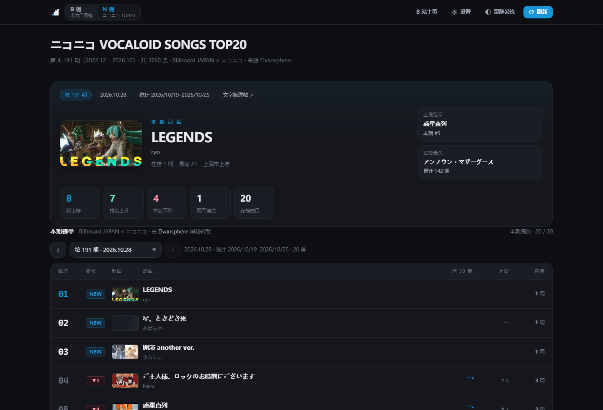
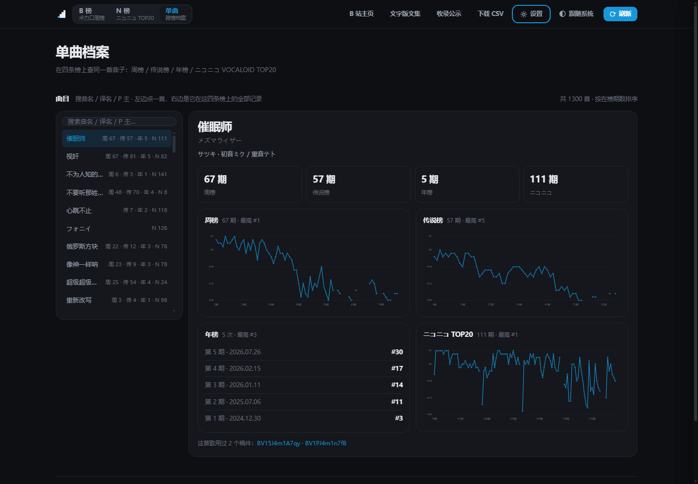
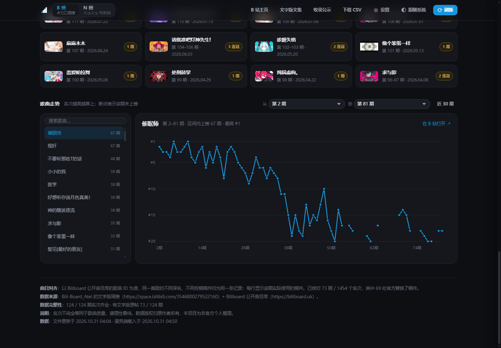

# 术力口周榜 · 数据看板

> 🤖 **AI 生成声明**
>
> 本项目的**代码、界面与数据整理均由 AI 生成**（模型：**DeepSeek-V4.1-Flash**），作者 **whatiscat**。
> 数据版权归 Bili-Board_Atel 制作组与 Biliboard 所有，本项目为非官方的个人整理。

把 B 站「术力口周榜」和 ニコニコ「VOCALOID SONGS TOP20」做成一块能随手翻的看板 ——
四条榜、一次切换、零第三方依赖，npm start 就能看。


## 它解决什么

榜单散在两处：B 站那边每周是一条视频加一份文字版，Biliboard 那边是一份公开曲目库。
「这周谁上来了、谁在连冠、一首歌累计在榜多少周、这周掉出去的是哪几首」——
这些没有现成的地方能看，得自己拿表格拼。

这个项目把两边对齐好，涨跌、连冠、在榜期数、逐期走势全部算完再下发，铺成一块能翻的看板。

## 功能

### 一眼看完一期

- **冠军卡**：大字曲名 + 在榜期数 / 历史最高 / 上周名次 / 已连冠几期，右边挂着「上周冠军」
  和「在榜最久」两条侧栏。
- **五个 KPI**：新上榜 / 排名上升 / 排名下降 / 冠军连庄 / 在榜曲目。
- **本期看点**：新上榜、上升最快、跌出榜单三栏，直接给到曲名和名次。
- **冠军榜**：连续夺冠合并成一段，一眼看出谁霸榜了几周。
- **本期榜单**：名次 / 涨跌 / 封面 / 曲名 / 近 30 期小折线 / 上周 / 在榜，点任意一行看详情。

### 四条榜，切换不打断阅读

- 标题里的「周榜」是个下拉：**周榜 / 传说榜 / 年榜**。切的是整页 —— 标题、概览、榜单、看点、
  冠军榜、走势、页脚口径一起换。三条榜的期号各自独立（传说榜第 84 期不是第 84 周），页面会写清楚。
- 顶栏还有个 **B 榜 ⇄ N 榜 ⇄ 单曲**：B / N 是两条独立的榜；
  **单曲**是第三种看法 —— 以一首曲子为中心，把它在这四条榜上的记录摊在一起（见下）。



### 单曲：一首曲子，四条榜

搜曲名 / 译名 / P 主，点一首，右边就是它的全套档案：

- **四个 KPI**：周榜在榜几期、传说榜几期、年榜上榜几次、ニコニコ 几期
- **每张榜一块**：走势图（年榜是名次清单，因为一共就 5 期），没上过的那张如实写「没上过这条榜」
- **换过的稿件**：一首歌用过几个 BV 都列出来
- 只在ニコニコ 榜上出现、从没进过 B 榜的曲子也能搜到

B 站那三条榜共用官方 song.id，直接按 id 查；ニコニコ 没有曲目库，只能按**日文曲名**归一化后匹配 ——
对不上时如实写「没上过」，不用「看起来像」去凑（那会把两首不同的歌黏在一起）。



### 详情抽屉：点任意一行

- 抽屉里是这首歌的**全部在榜记录**：哪一期第几名、当周用的哪个稿件。
- 一首歌换过几个投稿稿件也会认成同一首（曲目身份用官方 song.id），按钮直接切换对比。
- B 站视频就地播放，不用开新标签页。

### 走势图自选区间

默认画最近 30 期，两头都能改成任意起止期 —— 一首在榜 80 期的曲子，30 期窗口会把它压成一段斜线。
区间没动过时，点开一首不在窗口里的曲子会自动把窗口挪到它在榜的那一段。



### 网页里就能维护数据

右上角「设置」就是命令行那几件事，不用开终端：更新数据、同步官方库、抓帖、抓附榜、
数据报告、运行状态、体检、定时任务配置、语法自检、跑测试、打便携包。

长任务在后台跑，抽屉里实时显示日志；跑完自动重载页面数据。


### 数据可信

- **对齐校验**：官方曲目库与文字版逐名次比对，稿件不一致的条目记下来，页脚如实写出核对结果。
- **同步完整性闸门**：期次或曲目条数缩水、结构不合法，任一条不过就报错且**不写盘**，旧数据原样保留。
- **数据质量可查**：满员期数、缺名次、名次不连续、原帖覆盖、同步告警，同时在 API、页脚、
  数据报告、体检、运行状态里出现。
- **离线重解析**：原文 payload 存在本地，解析规则改了可以重算，不必重抓。

### 好看且能用

- 四种主题：跟随系统 / 深色 / 浅色 / OLED 纯黑；图表颜色读 CSS 令牌，切换不需要重绘数据。
- 动效只在数据变化时出现：换期依次入场、折线描线、封面淡入；**筛选框输入不重播**。
- 键盘可达：榜单行、冠军卡、歌曲按钮都能 Tab 到，Enter / 空格打开抽屉，Esc 关闭并还回焦点。
- 手机可用：窄屏重排成两列，没有横向溢出。
- 导出：任意一期可下载 CSV；禁用 JavaScript 时给出说明和全量导出入口。

## 快速开始

需要 Node.js ≥ 20.6。**没有依赖要装** —— 整个项目只用 Node 内置模块。

```bash
npm start          # 启动并打开 http://127.0.0.1:5173
```

仓库里已经带了一份数据快照，打开就有内容。想更新到最新一期：点右上角「设置」→「更新数据」。

常用命令：

```bash
npm start          # 起服务（默认端口 5173）
npm run update     # 同步 + 增量抓帖 + 附榜（命令行版）
npm run status     # 数据文件与最近一次跑批
npm run doctor     # 体检：数据、网络、目录
```

## 打包

两种产物，目标机器都不需要装任何依赖：

```bash
npm run package       # 便携版目录 + zip（目标机器要有 Node）
npm run package:exe   # 单个 exe，自带 Node，双击即用
```

单文件版约 83 MB，第一次启动会把自己解到 `%LOCALAPPDATA%\术力口周榜\`（约 30 MB，只解一次），
之后更新数据都写在那里。原理见 [开发文档](docs/DEVELOPMENT.md#单文件-exe-node-sea)。

## 数据来源

- **榜单本身**：B 站 [Bili-Board_Atel](https://space.bilibili.com/3546800279522160) 的每周文字版；
  曲目与名次的官方出处是 [Biliboard](https://biliboard.uk) 的公开曲目库。
- **ニコニコ 榜**：Billboard JAPAN × ニコニコ「VOCALOID SONGS TOP20」，
  由 [Elvansphere](https://space.bilibili.com/12446725) 译制转载。
- 数据版权归原作者所有，本项目为非官方的个人整理，仅供学习与自用。

## 更多

- 开发文档（目录结构、爬虫、数据管线、API、验收探针）：[docs/DEVELOPMENT.md](docs/DEVELOPMENT.md)
- 便携版打包：npm run package，产物在 dist/。
